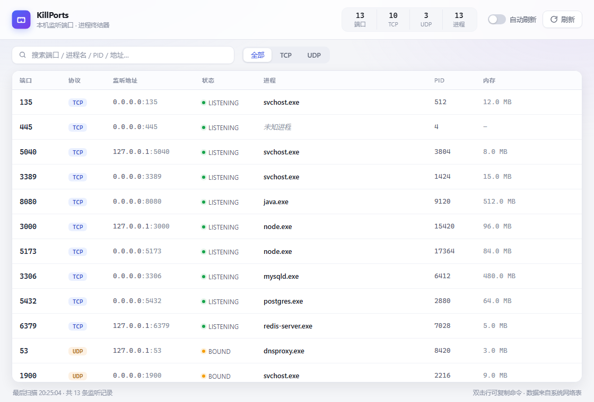

# KillPorts

基于 Tauri 2.0 的桌面工具：一键查看本机所有监听端口（TCP LISTEN + UDP 绑定），并可直接强制结束占用端口的进程。



## 功能

- 枚举本机全部监听端口，自动关联进程名 / PID / 可执行路径 / 内存占用
- 搜索过滤（端口、进程、PID、地址）、TCP / UDP 协议切换
- 结束进程需二次确认，禁止误杀自身（PID 0/4 与自身进程受保护）
- 每 4 秒自动刷新（可选开关，`Ctrl+R` 手动刷新，`Ctrl+F` 聚焦搜索）
- 检测管理员权限，支持"以管理员身份重启"（Windows）
- 双击表格行复制 `taskkill /F /PID <pid>` 命令

## 开发与构建

```bash
npm install         # 安装前端依赖
npm run app:dev     # 启动桌面应用（开发模式，热更新）
npm run app:build   # 构建发布包
```

发布产物：

| 文件 | 说明 |
| --- | --- |
| `src-tauri/target/release/kill-ports.exe` | 免安装单文件程序（约 3.2 MB） |
| `src-tauri/target/release/bundle/nsis/KillPorts_0.1.0_x64-setup.exe` | NSIS 安装包（约 1.2 MB） |

> 结束系统级服务（如 `svchost.exe`、`System`）通常需要以管理员身份运行，普通权限下会返回明确的失败提示。

## 技术实现

- 前端：Vite + TypeScript（原生，无框架），自绘表格 / 弹窗 / Toast
- 后端：Rust
  - `netstat2`：通过系统网络表（GetExtendedTcpTable / /proc）枚举套接字与所属 PID
  - `sysinfo`：PID → 进程名、可执行路径、命令行、内存占用，并执行强杀
  - `windows-sys`：`TokenElevation` 检测管理员权限、PowerShell `RunAs` 提权重启
- Tauri 命令：`list_listening_ports` / `kill_process` / `is_elevated` / `relaunch_as_admin`
- 单元测试：`cd src-tauri && cargo test`（枚举本机真实端口并校验排序）

## 目录结构

```
src/                 前端（main.ts 逻辑、styles.css 样式）
src-tauri/src/       ports.rs（端口枚举与进程操作）、lib.rs（命令注册）
scripts/             图标生成、窗口截图等辅助脚本（开发用）
docs/preview.png     界面截图
```

## 常见问题

**开发模式白屏 / 黑屏？**
`tauri.conf.json` 的 `devUrl` 必须写 `http://127.0.0.1:1420`。若写成 `localhost`，Windows 的 WebView2 会优先解析到 IPv6 `::1`，而 Vite 只监听 `127.0.0.1`，连接失败即白屏。

**结束进程失败（权限不足）？**
在应用顶部黄色提示条点击"以管理员身份重启"，或以管理员身份运行可执行文件。

**调试构建（`cargo build`）单独运行白屏？**
调试产物默认加载 `devUrl`，需要先 `npm run dev` 或直接使用 `npm run app:dev`。发布版已内嵌前端资源，可独立运行。
